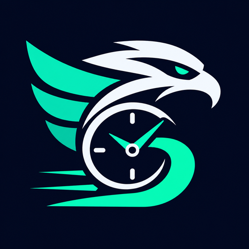

<p align="center">
  
</p>

<h1 align="center">DraBornSlot</h1>

<p align="center">Android’de Uber/Trendyol GO çalışma saatlerini planla, izle ve uygun saatleri işaretle.</p>

<p align="center">
  <a href="#güncel-android-apk"><strong>APK indir</strong></a> ·
  <a href="#kurulum">Kurulum</a> ·
  <a href="#kullanım">Kullanım</a> ·
  <a href="#sorun-giderme">Sorun giderme</a>
</p>

## Güncel Android APK

**[İmzalı Android APK’yı indir](https://github.com/DrabornEagle/DraBornStudio/releases/download/drabornslot-v0.7.2/DraBornSlot_RELEASE.apk)**

| Sürüm bilgisi | Değer |
| --- | --- |
| Güncel APK sürümü | v0.7.2 |
| Sürüm kodu | 13 |
| Android | 11 ve üzeri |
| Paket adı | `com.draborneagle.drabornslot` |
| İndirme dosyası | `DraBornSlot_RELEASE.apk` · 2,29 MiB |

[v0.7.2 sürüm notları](https://github.com/DrabornEagle/DraBornStudio/releases/tag/drabornslot-v0.7.2) · [SHA-256 dosyası](https://github.com/DrabornEagle/DraBornStudio/releases/download/drabornslot-v0.7.2/DraBornSlot_RELEASE.apk.sha256) · [Sürüm geçmişi](CHANGELOG.md)

<details>
<summary>v0.7.2 dosya ve imza doğrulaması</summary>

İndirilen APK’nın SHA-256 özeti

```text
db2296f77e07f3354c214172333abcd115598683ab71723cd15f4e905becfb55
```

Release imza sertifikasının SHA-256 parmak izi

```text
0a64224a27d2d0c705f7946af791f883e95c49b0e8bcc0ca2907d247575803f9
```

</details>

## Özellikler

| Özellik | Kullanım |
| --- | --- |
| Saat planı | Gününü seç ve sabah, öğle, akşam veya gece aralıklarını planla. **Tümünü seç** günün 34 zaman dilimini ekler. |
| İzleme | Trendyol GO’da görülen saat durumunu işlem geçmişine kaydeder. |
| Canlı seçim | Seçili gün ve saatler için Trendyol GO’nun görünür slot düğmelerini kullanır. |
| Yenileme aralığı | 1–60 saniye arasında ayarlanır. Varsayılan değer 1 saniyedir ve sayfanın yüklenme süresi gerçek yenileme aralığını etkiler. |
| Bağlantı koruması | **Bağlantıyı yenile** ile başlar. Boş planda da servisin durumunu izler ve bildirime durdurma seçeneği ekler. |

## Kurulum

1. APK’yı Android telefonuna indir ve açılan kurulum ekranından yükle. Uyumlu bir imzalı DraBornSlot sürümü kuruluysa üzerine güncelleyebilirsin.
2. DraBornSlot’u aç. **Erişilebilirlik** bölümünden Android ayarlarına geç ve **DraBornSlot slot ekranı otomasyonu** hizmetini etkinleştir.
3. Çalışma gününü ve saatlerini seç. Takip modunu ve yenileme aralığını ayarla. **Kaydet ve uygula** ile devam et.

## Kullanım

| Kaydet ve uygula seçeneği | Sonuç |
| --- | --- |
| **Uber/Trendyol GO aç** | Planı kaydeder ve kurye uygulamasına geçer. |
| **Slotları arka planda yakala** | Planı hazır tutar. Bildirim üzerinden GO’yu açabilir veya takibi durdurabilirsin. |
| **Yalnızca kaydet** | Planı kaydeder ve DraBornSlot ekranında kalır. |

- Canlı seçim için telefon kilitsiz ve GO saat ekranı görünür olmalı. Ekran kapandığında veya GO arka plana geçtiğinde plan bekler. GO tekrar görünür olduğunda takip devam eder.
- **Planı düzenle** ile kayıtlı seçimleri açabilirsin. Bir saat plandan çıkarıldığında **Kaldırmadan kaydet** yerel planı günceller. **GO’da da kaldır** ayrıca kurye uygulamasında kaldırma isteği oluşturur.
- **Takibi durdur** planı duraklatır. **Temizle** planı, bekleyen kaldırmaları, işlem geçmişini ve takip ayarlarını sıfırlar.
- İşlem geçmişi gönderilen dokunmayı ve ekranda görülen sonucu ayrı gösterir. Kesin kayıt durumunu GO’nun kayıtlı saatler ekranından kontrol et.

## v0.7.2’de neler yeni?

- **Erişilebilirlik Bağlantısı**, **Servis Tanısı** ve **Kayıtlı Planı Güncelle** pencereleri DraBornSlot temasına taşındı. Plan güncellemede çıkarılacak saatler gösteriliyor.
- **Bağlantıyı yenile** tarama oturumunu tazeliyor ve bağlantı korumasını açıyor. Android servisi geç bağlarsa bağlantı uyarısı kendiliğinden kapanıyor.
- **Servis Tanısı** son bağlantıyı, son kontrolü ve Android’in sağladığı süreç kapanış açıklamasını gösteriyor. **Kopyala** ile bilgileri alabilirsin.

[Önceki sürümlerin değişiklikleri](CHANGELOG.md)

## Sorun giderme

| Durum | İzlenecek adım |
| --- | --- |
| Erişilebilirlik açık, servis bağlantısı kesik | **Bağlantıyı yenile** seçeneğini kullan. Android servisi bağlamazsa **Ayarları aç** üzerinden DraBornSlot hizmetini kapatıp yeniden aç. |
| Plan hazır, slot işlemi başlamıyor | Telefonun kilidini aç ve Trendyol GO saat ekranını öne getir. Kayıtlı planın etkin olduğunu kontrol et. |
| Bağlantı koruması açık, bildirim görünmüyor | **Servis Tanısı → Bildirim izni ver** seçeneği görünüyorsa Android bildirim iznini aç. |
| Takibi veya bağlantı korumasını durdurmak istiyorum | Plan için **Takibi durdur** seçeneğini kullan. Bağlantı koruması için **Servis Tanısı → Korumayı durdur** seçeneğini kullan. |
| Android imza uyuşmazlığı gösteriyor | Telefonda kurulu sürümün imzasını kontrol et. Resmî imzalı sürümler aynı anahtarla güncellenir. |

Sorun bildirirken başlığa **DraBornSlot** yaz. Sürümü, Android sürümünü, telefon modelini ve sorunu yeniden görmek için izlediğin adımları ekle. Erişilebilirlik sorunlarında **Servis Tanısı → Kopyala** tanı bilgisini ekler. [GitHub sorunları](https://github.com/DrabornEagle/DraBornStudio/issues)

## Depodaki kaynak

Bu klasördeki Gradle projesi **v0.4.0** sürümündedir. Bu projenin mimarisini [ARCHITECTURE.md](ARCHITECTURE.md) dosyasında bulabilirsin. İmzalı v0.7.2 APK, [sürüm sayfasında](https://github.com/DrabornEagle/DraBornStudio/releases/tag/drabornslot-v0.7.2) yer alır.

---

DraBornSlot, DrabornEagle tarafından geliştirilen bağımsız bir Android uygulamasıdır.
