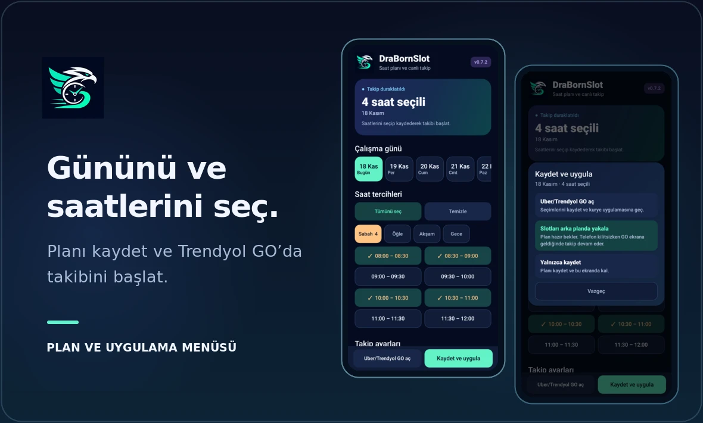

<h1 align="center">DraBornSlot</h1>
<p align="center">Trendyol GO çalışma gününü planla, uygun saatleri izle veya canlı seçimle işaretle.</p>

<p align="center">
  
</p>
<p align="center">
  <a href="https://github.com/DrabornEagle/DraBornStudio/releases/download/drabornslot-v0.7.2-r13/DraBornSlot_RELEASE.apk"></a>
</p>
<p align="center">
  <a href="#apk-indir">APK ve kurulum</a> · <a href="#v072-yenilikleri">Yenilikler</a> · <a href="#kullanım">Kullanım</a> · <a href="#kaynak-ve-derleme">Kaynak kod</a>
</p>

<p align="center">
  
</p>
<p align="center">
  <a href="docs/screens/plan.webp">Saat planı ekranı</a> · <a href="docs/screens/apply.webp">Kaydet ve uygula menüsü</a>
</p>

## APK indir

APK, **Android 11 ve üzeri** cihazlarda çalışır. Önceki DraBornSlot Release sürümünü aynı imzayla güncelleyebilirsin.

| Dosya | Açıklama |
| --- | --- |
| [DraBornSlot_RELEASE.apk](https://github.com/DrabornEagle/DraBornStudio/releases/download/drabornslot-v0.7.2-r13/DraBornSlot_RELEASE.apk) | İmzalı v0.7.2 APK · sürüm kodu 13 · 2,29 MiB |
| [SHA-256 dosyası](https://github.com/DrabornEagle/DraBornStudio/releases/download/drabornslot-v0.7.2-r13/DraBornSlot_RELEASE.apk.sha256) | İndirilen APK’nın bütünlük kontrolü |
| [DraBornSlot_v0.7.2_r13_Kaynak.zip](https://github.com/DrabornEagle/DraBornStudio/releases/download/drabornslot-v0.7.2-r13/DraBornSlot_v0.7.2_r13_Kaynak.zip) | Derlenebilir Android projesi ve testleri |

[GitHub Release ve dosyalar](https://github.com/DrabornEagle/DraBornStudio/releases/tag/drabornslot-v0.7.2-r13)

1. APK’yı Android cihazına indirip aç. Android kurulum izni isterse indirme yaptığın uygulama için izin ver ve kurulumu tamamla.
2. DraBornSlot’u aç. **Erişilebilirlik** düğmesinden Android ayarlarına git ve DraBornSlot hizmetini etkinleştir.
3. Çalışma gününü ve saatlerini seçip **Kaydet ve uygula** ile devam et.

<details>
<summary>APK paket adı, SHA-256 ve imza sertifikası</summary>

| Alan | Değer |
| --- | --- |
| Android paket adı | `com.draborneagle.drabornslot` |
| APK SHA-256 | `db2296f77e07f3354c214172333abcd115598683ab71723cd15f4e905becfb55` |
| Release sertifikası SHA-256 | `0a64224a27d2d0c705f7946af791f883e95c49b0e8bcc0ca2907d247575803f9` |

APK ve SHA-256 dosyası aynı klasördeyken `sha256sum --check DraBornSlot_RELEASE.apk.sha256` çalıştırabilirsin. Sertifikayı Android SDK’nın `apksigner verify --print-certs` komutuyla karşılaştırabilirsin.

</details>

## v0.7.2 yenilikleri

- **Uygulama tasarımıyla uyumlu pencereler.** Erişilebilirlik bağlantısı, servis tanısı ve kayıtlı plan güncelleme pencereleri yenilendi. Planı güncellerken çıkarılacak saatler gösterilir.
- **Bağlantı koruması.** **Bağlantıyı yenile** tarama oturumunu sıfırlar ve Android’in servisi yeniden bağlamasını izler. Koruma plan boşken de çalışır ve bildirimden durdurulabilir.
- **Ayrıntılı servis tanısı.** Android izni, servis bağlantısı, son takip kontrolü ve sistemin bildirdiği süreç kapanış açıklaması tek pencerede görünür. Sonucu kopyalayabilirsin.

[Tüm sürüm geçmişi](CHANGELOG.md)

## Kullanım

| Yapmak istediğin | Uygulamada izleyeceğin yol |
| --- | --- |
| Saat planı oluştur | Çalışma gününü seç. Sabah, öğle, akşam veya gece aralıklarını işaretle. **Tümünü seç** 34 zaman dilimini plana ekler. |
| Uygun saatleri izle | **İzleme** modunu seç. Görülen durumları **İşlem geçmişi** bölümünden takip et. |
| Seçtiğin saatleri işaretle | **Canlı seçim** modunu seç. **Kaydet ve uygula** menüsünden **Uber/Trendyol GO aç** ile saat ekranına geç. |
| Takibi hazır tut | **Slotları arka planda yakala** ile planı kaydet. Bildirimden kurye uygulamasına geçebilir veya takibi durdurabilirsin. |
| Planı düzenle veya sıfırla | **Planı düzenle** kayıtlı saatleri açar. **Temizle** takibi durdurur, planı ve geçmişi sıfırlar. |

> [!NOTE]
> Arka planda plan hazır bekler. Saat kontrolü ve seçim, telefon kilitsizken ve Uber/Trendyol GO’nun saat ekranı görünürken devam eder. Kesin kayıt durumunu GO’nun **Kayıtlı Saatler** ekranından kontrol et.

## Sorun giderme

- **Erişilebilirlik açık, servis bağlantısı kesik.** **Bağlantıyı yenile** ile yeniden bağlanmayı dene. Android bağlantıyı kuramazsa **Ayarları aç** ile DraBornSlot hizmetini kapatıp tekrar aç. **Servis tanısı** son durumu gösterir.
- **Takip bekliyor.** Telefonun kilidini aç ve Uber/Trendyol GO’da **Saatler → Tüm Saatler** ekranına dön.
- **APK güncellemesi yüklenemiyor.** Aynı Android paket adı ve özgün DraBornSlot Release sertifikası gerekir. İmza çakışması varsa mevcut kurulumu değiştirmeden önce saat tercihlerini kaydet.

## Kaynak ve derleme

Android projesi [DraBornSlot/](https://github.com/DrabornEagle/DraBornStudio/tree/drabornslot-v0.7.2-r13/DraBornSlot) klasöründe yer alır. GitHub etiketi, Gradle sürümü ve APK sürüm kodu v0.7.2 (13) yayınıyla eşleşir.

JDK 17, Gradle 8.9, Android SDK Platform 35 ve Build Tools 35.0.0 ile `DraBornSlot/` klasöründe çalıştır.

```bash
gradle :app:testDebugUnitTest :app:assembleRelease
```

Yerel imzasız derleme `app/build/outputs/apk/release/app-release-unsigned.apk` yoluna çıkar. Dağıtımdaki imzalı APK’yı **APK indir** bölümünden alabilirsin.

[Uygulama mimarisi](ARCHITECTURE.md) · [Cihazda sürüm kontrol listesi](tests/REVIEW-CHECKLIST.md) · [Lisans](../LICENSE)

DraBornSlot, DrabornEagle tarafından geliştirilen bağımsız bir Android uygulamasıdır. Erişilebilirlik hizmeti, seçtiğin gün ve saatlere göre görünür slot ekranını cihazda işler.
