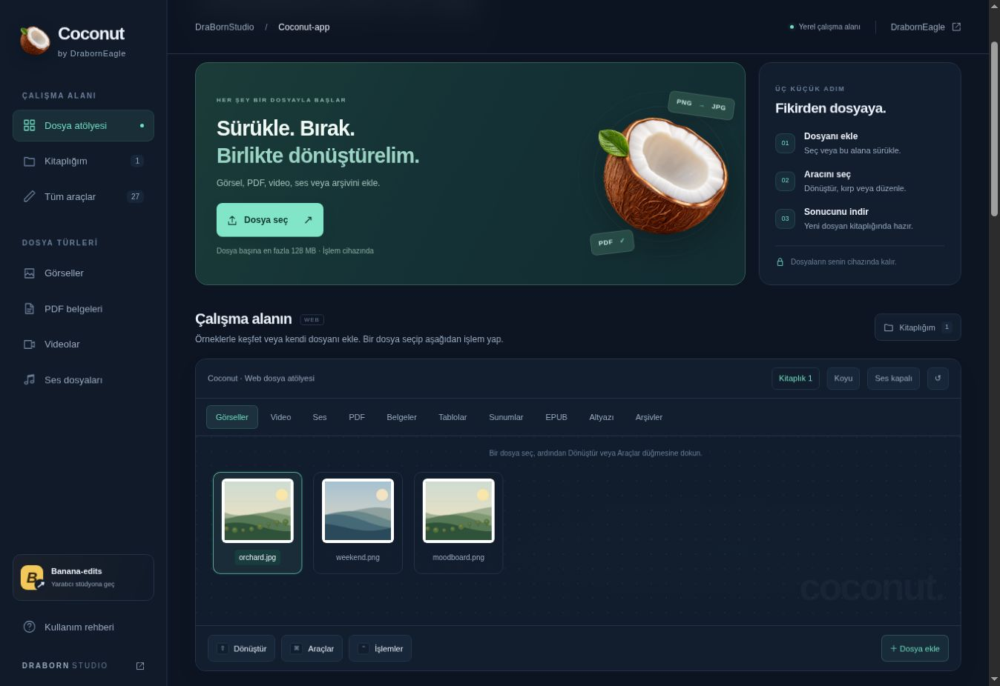

# DraBornStudio

DrabornEagle ekosisteminin üretkenlik ve yaratıcı medya uygulamaları. Geliştirme, dokümantasyon ve sürüm bakımı bu depoda yapılır.

| Klasör | Uygulama | Platform | Aç |
| --- | --- | --- | --- |
| [nashi-app](nashi-app/) | **Coconut-app** | Web, macOS, Windows | [Web](https://www.draborneagle.com/Coconut-app/) |
| [banana-studio](banana-studio/) | **Banana-edits** | Web, macOS, Windows | [Web](https://www.draborneagle.com/Banana-edits/) |
| [clipboardline](clipboardline/) | **clipboard-app** | macOS, Windows | [Kaynaklar](clipboardline/) |

## Web ve kaynak eşitleme

`nashi-app/web/` Coconut web kaynağıdır. `banana-studio/` Banana-edits geliştirme kaynağıdır. `scripts/sync-web.py /path/to/DrabornEagle_Web` komutu statik dağıtımı ve kaynak kopyalarını günceller; Banana-edits için önce `npm run build` çalıştır. Web dağıtımı DrabornEagle_Web üzerinden sürdürülür.

Her uygulamanın README dosyası kendi kurulumunu, yeteneklerini ve sınırlarını açıklar. Galeriler cihazdaki tarayıcıya aittir; bulut ve AI özellikleri ayrıca sunucu/sağlayıcı kurulumu ister. Masaüstü kaynakları tam aktarılmıştır; bu repo henüz yeni marka altında imzalı masaüstü binary dağıtmaz.

## Geliştirme ve katkı

İş ve hata kayıtları [Issues](https://github.com/DrabornEagle/DraBornStudio/issues) üzerinden yönetilir. Her değişiklikte uygulamanın testleri çalıştırılır; API anahtarları, gerçek kullanıcı medyası, yerel veritabanları ve imzalama anahtarları commit edilmez.

## Lisans ve kaynak başlangıcı

Bu uygulamalar MIT lisanslı açık kaynak projelerden geliştirilmiştir. DrabornEagle bu sürümlerin bakımını ve yeni geliştirmelerini yürütür. Özgün telif ve lisans bildirimleri her uygulamanın `LICENSE` dosyasında değiştirilmeden korunur; kaynak adresleri ve commit bilgileri `UPSTREAM.json` dosyalarındadır. DrabornEagle tarafından eklenen kod da MIT lisanslıdır. [Bildirimler](THIRD_PARTY_NOTICES.md).
